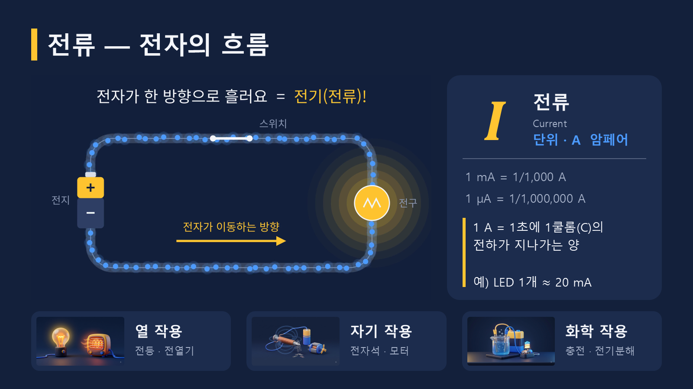
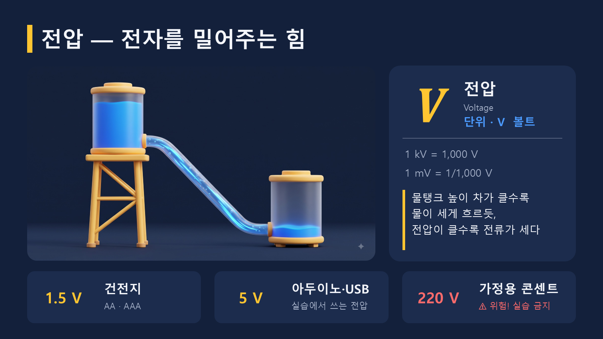
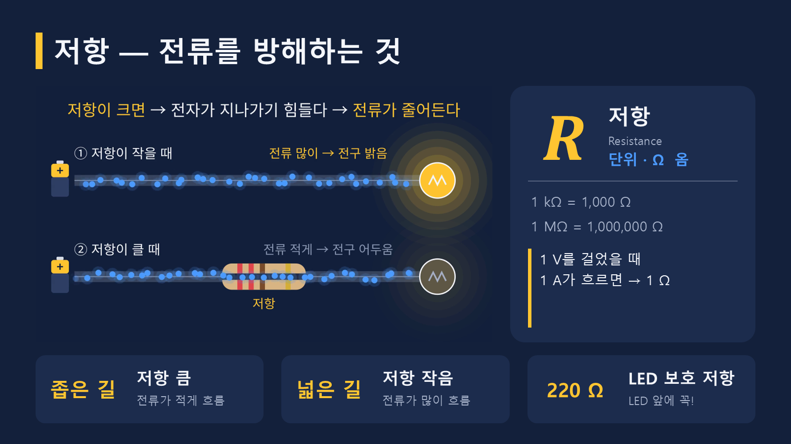
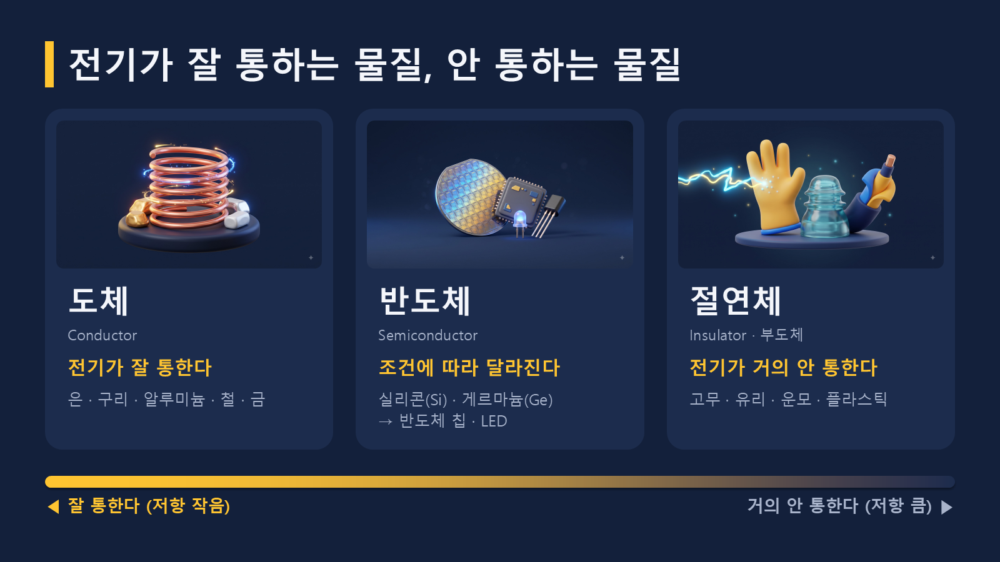
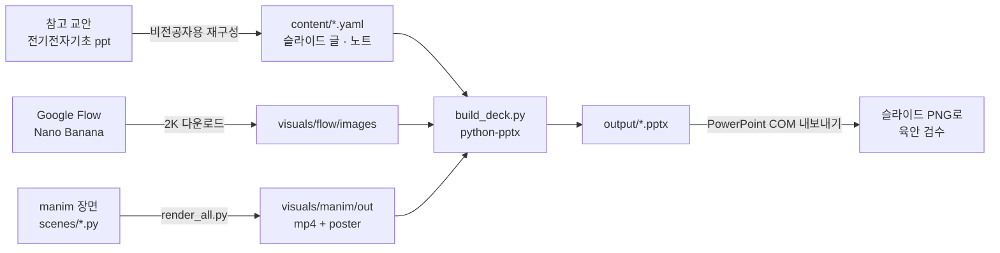

# 전자 기초 이론 — 그림으로 보는 전자전기 (청년 피지컬 AI)

전기·전자를 처음 배우는 **비전공자**를 위한 하루 특강용 PowerPoint 강의자료입니다.
아두이노·센서·모터 실습 전에 "전기가 무엇인지"를 글 대신 **그림과 애니메이션**으로 이해하도록 만들었습니다.

> 현재 버전: **1장 맛보기 (5장)** — 전류 · 전압 · 저항 · 도체/반도체/절연체. 전체(약 50장)로 확장 예정.

## 📥 다운로드

| 파일 | 내용 | 다운로드 |
|------|------|---------|
| **전자기초이론_1장_맛보기.pptx** (6.4 MB) | 최신 v2 — 1장 전압·전류·저항 5장 | [⬇ Release에서 받기](https://github.com/rlacksals0618-collab/physical-ai-electronics-basics/releases/latest/download/electronics-basics-ch1-v2.pptx) · [저장소 파일](output/전자기초이론_1장_맛보기.pptx) |
| 전자전기기초_맛보기.pptx (3.2 MB) | 이전 v1 — 「전기란 무엇인가」 5장 | [⬇ Release에서 받기](https://github.com/rlacksals0618-collab/physical-ai-electronics-basics/releases/latest/download/electronics-basics-ch1-v1.pptx) · [저장소 파일](output/전자전기기초_맛보기.pptx) |

- 영상(2·4번 슬라이드)은 슬라이드쇼(F5)에서 **자동 재생**됩니다. PowerPoint 2016 이상 권장.
- 글꼴: 맑은 고딕 (Windows 기본 글꼴).

## 👀 미리보기

| | |
|---|---|
|  |  |
| **1. 표지** | **2. 전류 — 전자의 흐름** (영상) |
|  |  |
| **3. 전압 — 전자를 밀어주는 힘** | **4. 저항 — 전류를 방해하는 것** (영상) |
|  | |
| **5. 전기가 잘 통하는 물질, 안 통하는 물질** | |

### 슬라이드 속 애니메이션 (manim)

| 전자의 흐름 (`p01_electron_flow`, 18초) | 저항의 효과 (`p01_resistance`, 13초) |
|---|---|
|  |  |
| 스위치가 열려 있으면 전자는 제자리에서 흔들리기만 함 → 스위치를 닫으면 한 방향으로 흐르고 전구가 켜짐 | 같은 전지·같은 전구에서 저항이 있는 길은 전자가 느리게 흘러 전구가 어두움 |

원본 영상: [`visuals/manim/out/`](visuals/manim/out/)

## 📚 강의 내용 (1장 맛보기 v2)

| # | 제목 | 화면 구성 | 핵심 내용 |
|---|------|---------|---------|
| 1 | 전자 기초 이론 · 1장. 전압·전류·저항 | 표지 일러스트 (Flow) | 오늘 배울 세 단어: 전류, 전압, 저항 |
| 2 | 전류 — 전자의 흐름 | 전자 흐름 영상 + 기호 카드 + 그림 칩 3개 | 기호 *I*, 단위 A(mA, μA). 1 A = 1초에 1 C. LED 1개 ≈ 20 mA. 전류의 3가지 작용: **열**(전등·전열기), **자기**(전자석·모터), **화학**(충전·전기분해) |
| 3 | 전압 — 전자를 밀어주는 힘 | 물탱크 높이 차 그림 + 기호 카드 + 값 칩 3개 | 기호 *V*, 단위 V(kV, mV). 높이 차 = 전압, 흐르는 물 = 전류. 실생활 전압 1.5 V(건전지) · 5 V(아두이노·USB) · 220 V(콘센트, ⚠ 실습 금지) |
| 4 | 저항 — 전류를 방해하는 것 | 저항 비교 영상 + 기호 카드 + 칩 3개 | 기호 *R*, 단위 Ω(kΩ, MΩ). 1 V에서 1 A가 흐르면 1 Ω. 영상 속 저항 색띠(빨강·빨강·갈색·금) = 실습용 **220 Ω** LED 보호 저항 |
| 5 | 전기가 잘 통하는 물질, 안 통하는 물질 | 그림 카드 3장 + 눈금 막대 | **도체**(은·구리·알루미늄…), **반도체**(실리콘·게르마늄 → 칩·LED), **절연체**(고무·유리·플라스틱…) |

모든 슬라이드에 **발표자 노트**가 들어 있습니다. 교안의 엄밀한 정의(쿨롬·줄 정의, 고유저항 10⁻⁴ / 10⁷ Ω·m 등)는 화면 대신 노트로 옮겼습니다.

## 🛠 제작 과정

### 원칙
- **글보다 그림.** 정의·기호·단위는 교안 그대로 두고, 설명은 그림과 비유(물탱크, 좁은 길/넓은 길)로 바꿉니다.
- **코드로 그린 도형 그림은 쓰지 않습니다.** 그림은 AI 일러스트, 움직임은 애니메이션, 수치는 그래프로 만듭니다.
- **실습과 연결.** 예시는 아두이노 실습에서 바로 만나는 값(5 V, LED 20 mA, 220 Ω)으로 고릅니다.
- **내용과 디자인 분리.** 글은 YAML, 그림은 `visuals/`, 배치는 Python 코드에 둬서 수정과 재빌드가 쉽습니다.

### 파이프라인



### 단계별로
1. **원고 재구성.** 참고 교안 1~5쪽(전류 → 전압 → 저항 → 도체·절연체·반도체)의 순서를 그대로 따르고, 글로 가득한 내용을 슬라이드 1장 = 개념 1개로 나눴습니다. 결과는 [`content/01_voltage_current.yaml`](content/01_voltage_current.yaml)에 있습니다.
2. **일러스트 생성 (Google Flow).**
   - 모델은 Nano Banana, 비율 16:9, 프롬프트당 2장을 만들어 1장을 골랐습니다. 채택본은 2K로 업스케일해 받았습니다.
   - 모든 프롬프트 앞에 공통 스타일 문구([`style_prefix.txt`](visuals/flow/style_prefix.txt))를 붙였습니다. 내용은 클레이 질감 3D, 남색 배경 `#13203B`, 글자 없음입니다. 그래서 그림 톤이 통일되고, 슬라이드 배경과도 자연스럽게 이어집니다.
   - 이미지별 프롬프트는 [`prompts.yaml`](visuals/flow/prompts.yaml)에 남겨서 언제든 다시 만들 수 있습니다.
3. **애니메이션 (manim).**
   - 전자 알갱이 수십 개를 `ValueTracker` 업데이터로 움직였습니다. 무작위 열운동과 한 방향 흐름(drift)을 합친 방식입니다.
   - 전구 밝기는 전류 크기에 맞춰 바뀝니다.
   - 공통 부품(전자, 전구)은 [`parts.py`](visuals/manim/parts.py), 색과 글꼴은 [`style.py`](visuals/manim/style.py)에 모았습니다.
   - 렌더링하면 1920×1080 30fps mp4와 마지막 프레임 포스터 이미지가 나옵니다. LaTeX나 ffmpeg는 따로 설치하지 않아도 됩니다(PyAV 사용).
4. **조립 (python-pptx).**
   - [`build_deck.py`](build/build_deck.py)가 YAML을 읽고, [`layouts.py`](build/layouts.py)의 레이아웃 함수로 슬라이드를 만듭니다.
   - 영상은 포스터 프레임과 함께 넣었습니다. 슬라이드 timing XML을 직접 써서 "이전 효과 다음에 자동 재생"이 되도록 했습니다.
5. **검수.**
   - PowerPoint COM으로 각 슬라이드를 PNG로 내보내 글자 넘침과 배치를 직접 확인하고 고쳤습니다.
   - 영상 자동 재생 효과가 들어갔는지도 COM으로 확인했습니다(MediaPlay, AfterPrevious).

### 디자인 토큰
| 이름 | 색 | 용도 |
|------|----|------|
| BG | `#13203B` | 배경 (manim·Flow 그림과 동일) |
| CARD | `#1C2C4D` | 카드·패널 |
| YELLOW | `#FFC531` | 강조, 전구 빛 |
| BLUE | `#4C9BFF` | 전자, 단위 |
| MUTED | `#A9B4CB` | 보조 글자 |
| RED | `#FF6B6B` | 경고 (220 V) |

## 🔗 참고자료

**강의 내용**
- 참고 교안: 「전기전자기초[1]」 (`전기전자기초[1]-undust2.ppt`, 91쪽) 중 1~5쪽 — 전류·전압·저항의 정의, 기호, 단위, 전류의 작용, 도체·절연체·반도체 분류. 교안 파일은 이 저장소에 포함하지 않습니다(저작권은 원 저작자에게 있음).

**도구**
- [Google Flow](https://labs.google/flow) — AI 일러스트 생성 (Nano Banana)
- [Manim Community v0.22](https://www.manim.community/) — 수학·과학 애니메이션
- [python-pptx 1.0.2](https://python-pptx.readthedocs.io/) — PPTX 생성
- [PyAV](https://pyav.org/) — 영상 길이·포스터 프레임 추출
- [matplotlib](https://matplotlib.org/) — 그래프 (2장 이후 사용 예정)
- 글꼴: [Noto Sans KR](https://fonts.google.com/noto/specimen/Noto+Sans+KR) (영상), 맑은 고딕 (슬라이드)
- 제작 보조: [Claude Code](https://claude.com/claude-code) — 원고 재구성, 코드 작성, Flow 브라우저 작업, 검수

## 📁 폴더 구조

```
slides/
├─ content/                 슬라이드 글·발표자 노트 (YAML, 파트별 1파일)
│  ├─ 01_voltage_current.yaml
│  └─ _v1/                  이전 맛보기(v1) 원고 — 빌드에서 제외
├─ visuals/
│  ├─ flow/                 style_prefix.txt · prompts.yaml · images/ (Flow 2K 채택본)
│  ├─ manim/                style.py · parts.py · scenes/{ID}.py · render_all.py → out/{ID}.mp4 + _poster.png
│  └─ charts/               matplotlib 그래프 (예정)
├─ build/                   theme.py(색·글꼴) · layouts.py(레이아웃) · build_deck.py(조립)
├─ docs/preview/            README용 미리보기 이미지·GIF
└─ output/                  결과 pptx
```

시각자료 ID 규칙: `p{파트}_{이름}` (예: `p01_water_tank`). YAML에서는 `flow/p01_water_tank`, `manim/p01_resistance`처럼 참조합니다.

**레이아웃:** `cover` · `section` · `figure_caption` · `video_caption` · `compare` · `concept`(그림/영상 + 기호·단위 카드 + 칩 3개) · `three_cards`(3분류 + 눈금 막대)

## ▶ 직접 빌드하기

Windows + Python 3.12 기준입니다. manim 영상에는 Noto Sans KR 글꼴이 필요합니다.

```powershell
py -V:3.12 -m venv .venv
.venv\Scripts\pip install -r requirements.txt

.venv\Scripts\python visuals\manim\render_all.py            # 애니메이션 전체 렌더 (ID를 주면 그것만)
.venv\Scripts\python build\build_deck.py                    # → output\전자기초이론_1장_맛보기.pptx
```

## 🗺 앞으로

- [ ] 교안 6쪽~: 고유저항, **옴의 법칙**(전압을 바꾸면 전류가 바뀌는 애니메이션), 직렬·병렬 연결
- [ ] 2장 이후: 다이오드·LED, 트랜지스터, 센서·모터 — 아두이노 실습 연결
- [ ] matplotlib 그래프(V–I 특성 등) 추가

## ⚠ 알아두기
- `visuals/flow/images/`의 일러스트는 Google Flow로 생성한 AI 이미지입니다. 오른쪽 아래의 ✦ 표시는 Flow 생성 표시로, 일부러 남겨 두었습니다.
- 220 V 가정용 전원은 실습에 사용하지 않습니다 (슬라이드에도 "⚠ 위험! 실습 금지"로 표시).
